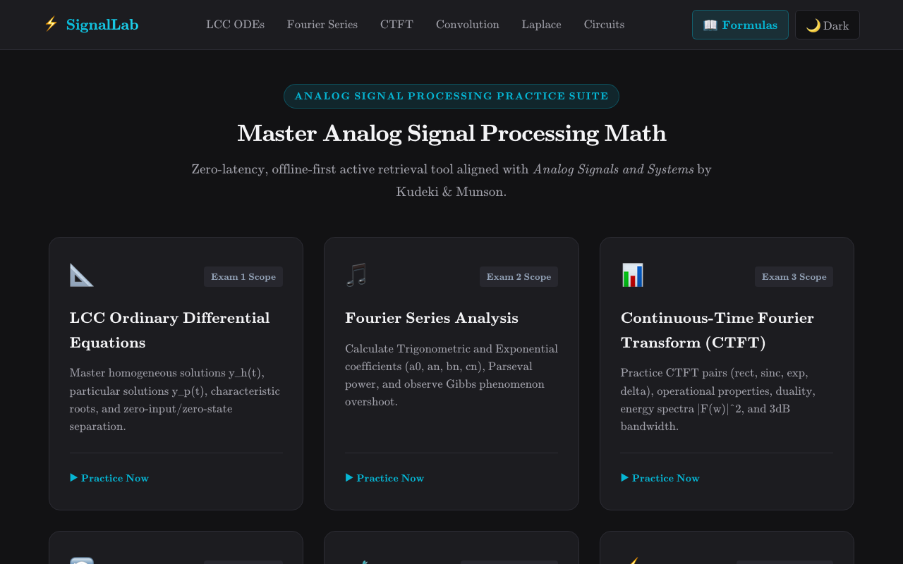
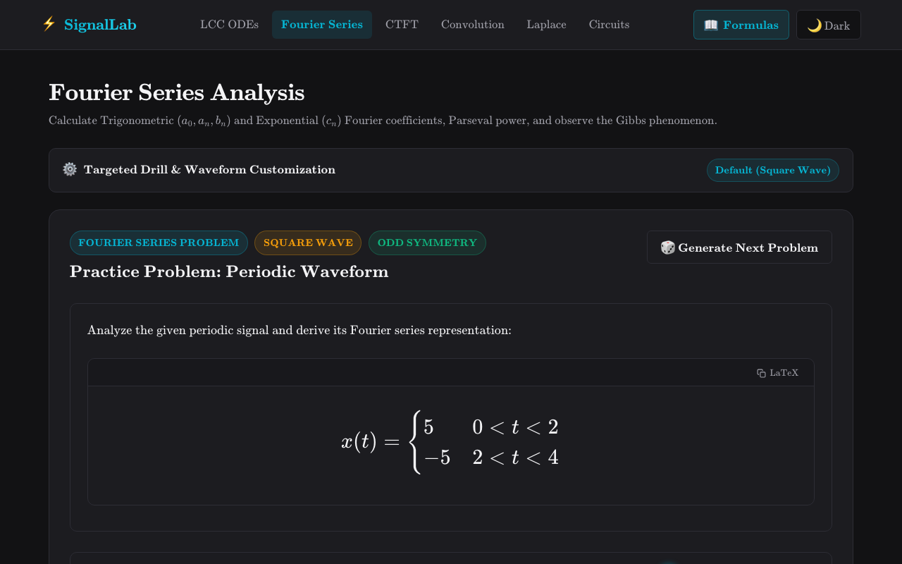
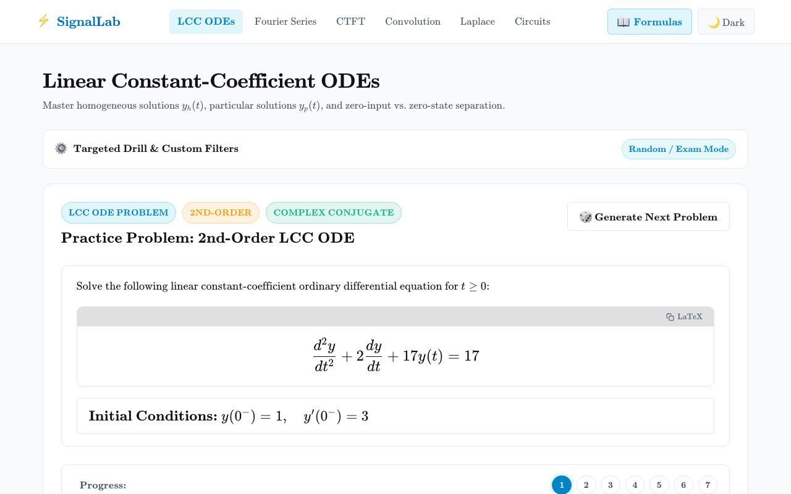

# 🔬 SignalLab

An interactive, offline-first Intelligent Tutoring System (ITS) and practice laboratory for university-level **Analog Signal Processing & Linear Systems**.



---

## ✨ Overview

**SignalLab** provides undergraduate and graduate engineering students with an interactive, step-by-step practice environment for mastering continuous-time signals and systems. Designed around cognitive tutoring principles, SignalLab breaks complex signal processing problems into structured sub-steps, evaluates student inputs with exact symbolic math normalization, and delivers real-time diagnostic feedback.

### Key Capabilities

- 🧩 **Zero-Guesswork Step Solvers**: Step-by-step problem workflows showing characteristic roots, differential trial ansatzes, systems of linear equations, and partial fraction expansions.
- 📐 **Symbolic Math Normalization**: Powered by `@cortex-js/compute-engine` with AST normalization tolerant of student shorthand, equivalent algebraic groupings, and fractional forms.
- 💡 **Adaptive Diagnostic Feedback**: Real-time syntax checking, multi-tiered hints, and step-specific error classification.
- 📊 **Interactive Canvas Visualizers**: Dynamic canvas plots for Fourier harmonic series synthesis and continuous-time signal analysis.
- 🔒 **100% Client-Side & Private**: Practice runs entirely in the browser with zero external telemetry or tracking, with PWA asset caching for offline use and theme preferences saved in `localStorage` when available. Solver sessions and practice history are not persisted across reloads.
- 📱 **Fluid & Accessible**: Fully accessible via keyboard (`:focus-visible`), with responsive layouts verified down to $320\text{px}$ viewports (WCAG 2.1 Reflow).

---

## 📚 Practice Modules

| Module                                | Core Topics & Capabilities                                                                                                                                  |                        Route                         |
| ------------------------------------- | ----------------------------------------------------------------------------------------------------------------------------------------------------------- | :--------------------------------------------------: |
| **Differential Equations**            | Characteristic equation roots, zero-input response ($y_{ZI}$), zero-state response ($y_{ZS}$), total response ($y_{\text{total}}$), and BIBO stability.     |              [`/odes`](src/routes/odes)              |
| **Continuous-Time Convolution**       | Graphical convolution, sliding window integration, interval partitioning, and composite piece-wise response computation.                                    |       [`/convolution`](src/routes/convolution)       |
| **Fourier Series Representation**     | Trigonometric & compact exponential Fourier series, Dirichlet conditions, line spectra, and harmonic synthesis.                                             |    [`/fourier-series`](src/routes/fourier-series)    |
| **Continuous-Time Fourier Transform** | Forward and inverse CTFT, spectral density $\lvert X(j\omega) \rvert$, phase spectra, duality, modulation, and differentiation properties.                  | [`/fourier-transform`](src/routes/fourier-transform) |
| **Laplace Transform & ROC**           | Unilateral/bilateral Laplace transforms, pole-zero constellations, Region of Convergence ($\text{ROC}$), and Partial Fraction Decomposition ($\text{PFD}$). |           [`/laplace`](src/routes/laplace)           |
| **Analog Circuit Analysis**           | $s$-domain impedance equivalence, nodal/mesh analysis, transfer function $H(s)$ derivation, and transient step/impulse responses.                           |          [`/circuits`](src/routes/circuits)          |

---

## 📸 Visual Showcase

|               Fourier Series Analysis & Live Harmonic Synthesis               |                 Second-Order ODE Response Solver                  |
| :---------------------------------------------------------------------------: | :---------------------------------------------------------------: |
|  |  |

---

## 🚀 Quickstart

### Prerequisites

- [Node.js](https://nodejs.org/) `22.x` from `v22.22.1`, or `v24.12.0` and higher (`24.x` is recommended for the resolved dependencies).
- `npm` `v10.0.0` or higher

### Local Setup

```bash
# Clone the repository
git clone <repository-url>
cd "Analog Signal Processing Practice"

# Install dependencies
npm install

# Start development server
npm run dev
```

Open [http://localhost:5173](http://localhost:5173) in your browser to start practicing.

---

## GitHub Pages deployment

Configure **Settings → Pages → Source → GitHub Actions** once. Pushes to `main` and manual dispatch build with the Pages `BASE_PATH`, verify the artifact using `npm run test:pages`, and deploy only after verification passes. PR checks exercise both root and project hosting. See the [Pages verification guide](./docs/development-and-testing.md#github-pages-artifact-verification).

## 📖 Technical Documentation

- 🛠️ **[Development & Testing Guide](docs/development-and-testing.md)** — Contributor setup, dual-runtime Vitest architecture (ADR `0025`), Playwright E2E suites, AST math testing, and formatting standards.
- 📐 **[Terminology & Mathematical Standards](docs/terminology-standards.md)** — Canonical signal processing symbols, operator conventions, and notation rules.
- 🏛️ **[Architectural Decision Records (ADRs)](docs/adrs/)** — Records of foundational design, mathematical engine, and UI decisions.
- 🤖 **[Workspace Agent Rules](.agents/AGENTS.md)** — Development guidelines for LaTeX math formatting, component styling, and code quality.

---

## 📄 License

This project is licensed for **non-commercial educational use** under the [PolyForm Noncommercial License 1.0.0](LICENSE.md).
