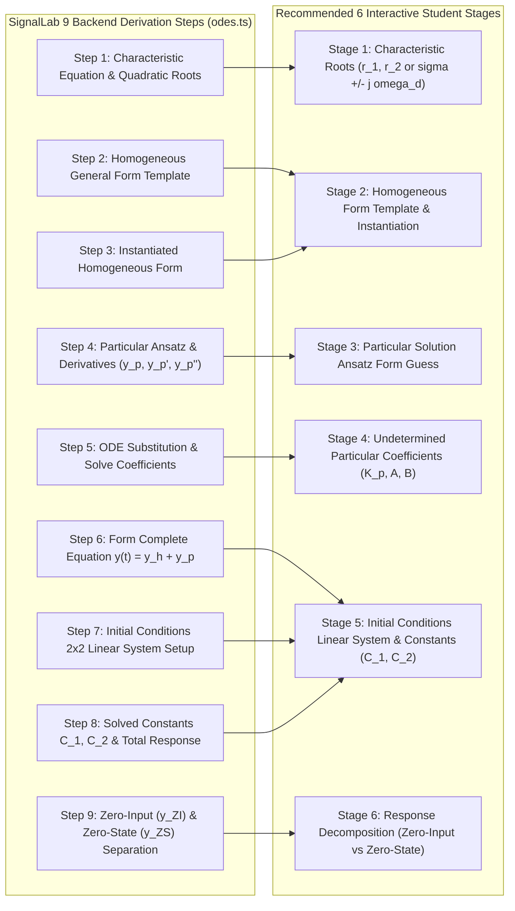

# 15. Six-Stage Interactive ITS Mapping for Linear Constant-Coefficient ODEs

## Context and Problem Statement

SignalLab's mathematical engine (`src/lib/math-engine/odes.ts`) generates **9 granular algebraic derivation steps** for every 2nd-order Linear Constant-Coefficient (LCC) ordinary differential equation (ODE) problem. These 9 steps were designed to adhere to the _Zero-Guesswork Step Breakdown Rule_ ([ADR 0006](0006-zero-guesswork-step-breakdown-pipelines.md)) for the complete post-solve solution walkthrough.

When converting the ODE practice module into an interactive **Intelligent Tutoring System (ITS)**, two extremes must be avoided:

1. **The Overly Collapsed Model (Canvas 4-Step)**: Reference solvers like the Gemini Canvas ODE solver collapsed the derivation into only 4 steps, omitting underdamped complex roots, initial condition velocity shifts ($y_p'(0^+)$ offsets), and Zero-Input ($y_{ZI}$) vs. Zero-State ($y_{ZS}$) response decomposition.
2. **The Overly Fragmented Model (9 Interactive Prompts)**: Asking students to submit 9 separate interactive forms creates artificial friction on trivial micro-steps (e.g. prompting the student to select the general template $C_1 e^{r_1 t} + C_2 e^{r_2 t}$ in Step 2, and immediately prompting them again in Step 3 to re-type $C_1 e^{-t} + C_2 e^{-2t}$).

## Decision Drivers

- Maintain full coverage of the ECE 210 and Analog Signal Processing curriculum (including underdamped oscillations, derivative offsets, and $y_{ZI}/y_{ZS}$ energy separation).
- Create an engaging, high-momentum interactive pacing that does not overburden students with redundant micro-prompts.
- Preserve the complete 9-step zero-guesswork mathematical walkthrough upon final solution completion.

## Considered Options

- **Option 1 (Canvas 4-Step Model)**: Adopt the 4-step collapsed flow, dropping underdamped complex roots and ZI/ZS decomposition.
- **Option 2 (Strict 9-Prompt Interactive Flow)**: Convert every one of the 9 backend steps into an individual student input prompt.
- **Option 3 (6-Stage Interactive ITS Mapping with Full 9-Step Reveal)**: Cluster the 9 backend derivation steps into 6 high-value interactive student checkpoints during active solving, while revealing all 9 granular algebraic steps in the post-solve solution breakdown.

## Decision Outcome

Chosen Option: **Option 3**, because it strikes the optimal balance between interactive problem-solving pacing and mathematical rigor.

### 9-to-6 Mapping Alignment

### Stage Descriptions

| Stage                             | Input Type                                     | Description & Pedagogical Rationale                                                                                                                                  |
| :-------------------------------- | :--------------------------------------------- | :------------------------------------------------------------------------------------------------------------------------------------------------------------------- |
| **Stage 1: Roots**                | Numeric Inputs                                 | Student factors $s^2 + a_1 s + a_0 = 0$ and inputs roots ($r_1, r_2$ or $\sigma \pm j\omega_d$).                                                                     |
| **Stage 2: Homogeneous Form**     | Canonical Selector Chips                       | Student selects the damping template; the system auto-instantiates the expression using validated roots from Stage 1 (mapping Steps 2 & 3).                          |
| **Stage 3: Particular Ansatz**    | Canonical MCQ Cards                            | Student selects the trial ansatz $y_p(t)$, testing for resonance collisions ($e^{rt}$ root matches requiring a $t$ multiplier) or sinusoidal pairs (mapping Step 4). |
| **Stage 4: Particular Constants** | Numeric Inputs                                 | Student substitutes $y_p(t)$ into the ODE and inputs solved coefficients $K_p$ or $C, D$ (mapping Step 5).                                                           |
| **Stage 5: Initial Conditions**   | Numeric Inputs                                 | Student sets up the $2\times 2$ linear system accounting for $y_p(0^+)$ and $y_p'(0^+)$ and inputs solved constants $C_1, C_2$ (mapping Steps 6, 7 & 8).             |
| **Stage 6: Response Separation**  | Structured Builder (`OdeResponseInput.svelte`) | Student partitions total solution into $y_{ZI}(t)$ (natural energy) and $y_{ZS}(t)$ (forced input) (mapping Step 9).                                                 |

### Post-Solve Full Derivation Reveal

Upon completing Stage 6, the system displays the complete 9-step step reveal (`StepReveal.svelte`) along with the live interactive response waveform canvas (`WaveformCanvas.svelte`).

## Consequences

### Positive

- Students practice the crucial high-failure steps (resonance, derivative offsets, $y_{ZI}/y_{ZS}$ separation) without getting bogged down by micro-prompts.
- Fully compatible with 1st-order and 2nd-order (Overdamped, Critically Damped, Underdamped) systems.
- Zero algebraic steps are skipped in the final solution breakdown.

### Negative / Trade-offs

- Requires managing state transitions across 6 interactive stages within `OdeStepSolver.svelte`.

### Neutral

- The backend ODE engine (`odes.ts`) remains the authoritative computation source for both interactive stage targets and the full 9-step solution.
