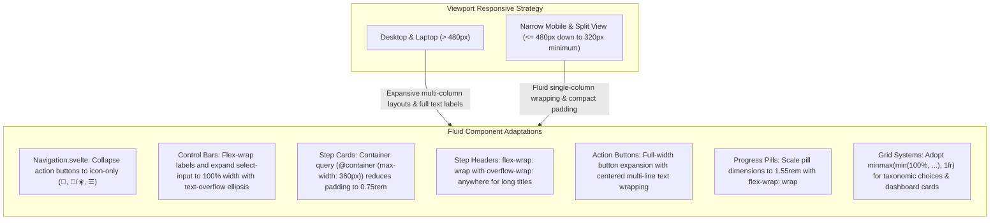

# 16. Narrow Viewport Responsive Layout Architecture and Fluid Small-Screen Hardening

## Context and Problem Statement

SignalLab is an interactive, browser-based analog signal processing workbench used across diverse devices and viewport configurations, ranging from ultra-wide desktop monitors to compact mobile smartphones, foldables, and narrow multi-window split panes (such as 320px–360px viewport widths).

An automated responsive audit across all application routes (`/`, `/odes`, `/convolution`, `/fourier-series`, `/fourier-transform`, `/laplace`, `/circuits`) revealed several critical layout overflow failure modes when rendered on narrow screens ($< 360\text{px}$, down to the $320\text{px}$ WCAG reflow baseline):
1. **Global Navigation Overflow**: The navigation bar displayed three full-label action buttons (`📖 Formulas`, `☰`, `🌙 Dark`) side-by-side with the brand title (`⚡ SignalLab`), requiring $\ge 451\text{px}$ of horizontal width and forcing a global horizontal scrollbar on every page.
2. **Unwrapped Control Groups and Long Dropdowns**: Control bars pairing long text labels with descriptive `<select>` options (e.g. `Rectangular Pulse * Rectangular Pulse...`) lacked flex wrapping, projecting up to $715\text{px}$ wide.
3. **Solver Card and Progress Bar Clipping**: Stepped solvers featured fixed-width progress pills (e.g. 6 pills spanning $> 208\text{px}$ + card padding), non-wrapping step headers, and primary action buttons styled with `justify-content: flex-end` that pushed overflowing button bounds outside the left edge of step cards.
4. **Rigid Grid Minimum Widths**: Multi-column grids (such as dashboard module cards and taxonomic option matrices) used rigid `minmax(340px, 1fr)` or `minmax(200px, 1fr)` tracks that exceeded narrow viewport bounds.

## Decision Drivers

- **Zero Unintentional Horizontal Scroll**: Ensure `document.documentElement.scrollWidth <= document.documentElement.clientWidth` across all routes on viewports down to the $320\text{px}$ minimum standard.
- **Flawless Small-Screen Usability**: Guarantee that all interactive controls (step buttons, dropdowns, inputs, progress pills, hints, and formulas) remain fully accessible and bounded within cards on mobile devices and narrow split panes.
- **Preservation of Desktop and Tablet Aesthetics**: Preserve expansive multi-column grid layouts, full-text navigation labels, and spacious card padding on viewports $> 480\text{px}$ without regression.
- **Strict WCAG Reflow Compliance**: Adhere to WCAG 2.1 Reflow (1.4.10) requiring content to reflow down to $320\text{px}$ without two-dimensional scrolling, while avoiding maintenance overhead for non-standard sub-$300\text{px}$ edge cases.

## Considered Options

- **Option 1 (Fixed-Width Layout with Horizontal Scroll Containers)**: Maintain rigid desktop element dimensions and wrap modules in `overflow-x: auto` scroll containers.
- **Option 2 (Dedicated Mobile Route / Component Duplication)**: Maintain separate mobile-specific view templates or fork solver components into mobile and desktop variants.
- **Option 3 (Fluid Component Architecture via Container Queries, Adaptive Flex Wrapping, and Responsive Navbar Collapsing)**: Implement a unified, fluid design system leveraging CSS Container Queries (`@container`), adaptive media queries (`@media (max-width: 480px)`), collapsible icon-only navigation buttons on mobile, full-width wrapping for control groups and action buttons, and scalable progress pills.

## Decision Outcome

Chosen Option: **Option 3**, because it establishes a maintainable, single-source responsive design system that seamlessly scales from 320px mobile split panes to 4K desktop screens without component duplication or cumbersome horizontal scrolling.

### Architectural Blueprint

### Key Technical Patterns

1. **Collapsible Mobile Navigation (`Navigation.svelte`)**:
   Wrap button text in `...` and apply `@media (max-width: 480px) { .btn-label { display: none; } }`. The navbar condenses into clean, compact icon buttons (`📖`, `🌙`/`☀️`, `☰`), reducing total navbar action width from $274\text{px}$ to $< 130\text{px}$.
2. **Defensive Control Group Flex Wrapping (`+page.svelte` routes)**:
   Ensure all `.control-group` containers specify `flex-wrap: wrap; width: 100%; gap: 0.4rem;` and `.select-input` elements have `max-width: 100%; width: 100%; text-overflow: ellipsis;`.
3. **Container-Query-Driven Step Cards (`FourierStepSolver.svelte`, `OdeStepSolver.svelte`)**:
   Leverage `container-type: inline-size;` on `.step-card` with `@container (max-width: 360px)` rules to dynamically compress padding (`0.75rem 0.85rem`) and expand `.btn-primary` action buttons to `width: 100%; justify-content: center; text-align: center;`.
4. **Adaptive Progress Pills**:
   Update `.progress-pills` to `flex-wrap: wrap; gap: 0.35rem;` and size pills at `1.55rem` ($24.8\text{px}$) with `font-size: 0.75rem;`, guaranteeing that all 6 stage pills comfortably fit in a single row down to $240\text{px}$ container width.
5. **Fluid Grid Track Clamping**:
   Replace rigid CSS grid minimums (`minmax(340px, 1fr)`) with clamped fluid tracks (`minmax(min(100%, 260px), 1fr)` and `minmax(min(100%, 140px), 1fr)`), preventing grid items from overflowing their parent bounding boxes.

## Consequences

### Positive
- Prevents horizontal layout overflow and unwanted scrollbars across all 7 routes at narrow viewports ($320\text{px} \le \text{width} \le 375\text{px}$).
- Touch targets and action buttons remain large, legible, and easily clickable on mobile devices.
- Single-source maintenance: desktop and mobile share identical Svelte component markup and state logic.

### Negative / Trade-offs
- Requires careful handling of multi-line button labels and flex alignment rules across stepped solvers.
- Narrow mobile screens display truncated select option labels via `text-overflow: ellipsis` when closed.

### Neutral
- Standard CI and routine test suites target the $320\text{px}$ WCAG reflow baseline and standard mobile viewports ($375\text{px}$), providing 100% real-world mobile coverage without maintenance overhead for sub-300px edge devices.
