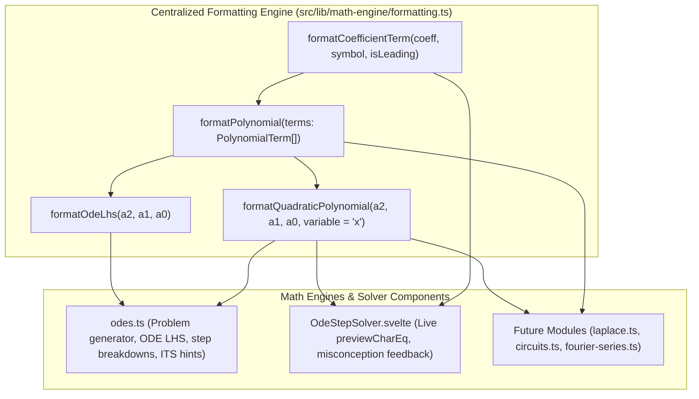

# 17. Centralized Mathematical LaTeX Formatting Utilities and Unit Coefficient Omission

## Context and Problem Statement

Mathematical typography in LaTeX requires strict conventions regarding algebraic coefficients and operator signs:

1. **Unitary Coefficient Omission**: A coefficient of $+1$ or $-1$ multiplied by a variable, derivative operator, or function symbol ($y(t)$, $\frac{dy}{dt}$, $s$, $x$) must omit the numeral $1$ (e.g., $+ y(t)$ instead of $+ 1y(t)$, $- \frac{dy}{dt}$ instead of $- 1\frac{dy}{dt}$, and $+ s$ instead of $+ 1s$).
2. **Sign Formatting**: Negative terms must not produce compound signs (such as $+ -1$ or $+ -3s$) and must render clean minus operators ($- y(t)$ or $- 3s$).
3. **Pure Constants**: Constants without a variable symbol ($a_0 = \pm 1$) must preserve the numeral $1$ while maintaining correct unary/binary signs ($+ 1$ or $- 1$).

Previously, problem generators and solvers constructed LaTeX equation strings via ad-hoc string interpolation (e.g. `\frac{d^2 y}{dt^2} + ${a1} \frac{dy}{dt} + ${a0} y(t) = ...`), leading to visual anomalies like $\frac{d^2 y}{dt^2} + 2\frac{dy}{dt} + 1y(t) = 2$ or $s^2 + -1s + -1 = 0$.

Furthermore, architectural decisions were required regarding where to locate algebraic formatting logic:

- Keeping helpers local to `src/lib/math-engine/odes.ts` would duplicate logic across Laplace, Fourier, and Circuits engines (violating Universal Rule 9: DRY Code & Shared Type Centralization).
- Colocating algebraic helpers inside `src/lib/math-engine/fraction.ts` conflates rational number continued-fraction reduction (`toFractionLatex`) with general algebraic polynomial string formatting.
- The quadratic polynomial formatter needed a standard default indeterminate variable ($x$) rather than assuming domain-specific variables ($s$, $t$, $\omega$).

## Decision Drivers

- **Mathematical Typographic Fidelity**: Ensure clean LaTeX output across all problem cards, step breakdowns, hint strings, and live preview equations without spurious unit numerals or sign anomalies.
- **Universal Rule 9 (DRY & Centralized Shared Utilities)**: Avoid duplicating coefficient formatting, polynomial construction, or sign-handling logic across individual math modules.
- **Separation of Concerns**: Keep rational fraction arithmetic/formatting distinct from algebraic polynomial and differential operator formatting.
- **Domain Generality with Flexible Overrides**: Default polynomial utilities to standard mathematical conventions ($x$) while allowing explicit domain variables ($s$ for Laplace/characteristic roots, $t$ for time, $\omega$ for frequency).

## Considered Options

- **Option 1: Ad-hoc localized string templates in `odes.ts`**: Format ODE and characteristic strings within `odes.ts` using local ternary expressions.
- **Option 2: Colocating polynomial helpers in `fraction.ts`**: Place `formatCoefficientTerm` and `formatPolynomial` inside the existing `fraction.ts` module.
- **Option 3: Dedicated centralized formatting module (`src/lib/math-engine/formatting.ts`)**: Create a standalone math formatting module providing pure algebraic formatting utilities with comprehensive unit tests and generic defaults.

## Decision Outcome

Chosen Option: **Option 3**, because it provides a clean, single-source formatting engine that adheres to DRY principles, respects separation of concerns, and supports arbitrary polynomial/differential expressions across all modules.

### Architectural Blueprint

### Module Interface Specifications

1. **`formatCoefficientTerm(coeff: number, symbol?: string, isLeading?: boolean): string`**:
    - Omits magnitude when `|coeff| === 1` and `symbol !== ""`
    - Handles sign placement for leading vs. non-leading positions (`-y(t)` vs. `- y(t)`)
    - Preserves pure constant magnitudes (`coeff === 1, symbol === ""` $\to$ `"+ 1"`)
    - Returns empty string when `coeff === 0`.
2. **`formatPolynomial(terms: PolynomialTerm[]): string`**:
    - Filters out zero-coefficient terms, formats each non-zero term with proper leading/interstitial signs, and returns `"0"` if all terms are zero.
3. **`formatQuadraticPolynomial(a2: number, a1: number, a0: number, variable = "x"): string`**:
    - Formats standard 2nd-order quadratic equations ($a_2 x^2 + a_1 x + a_0 = 0$).
    - Defaults to independent variable symbol `"x"`, with full support for domain-specific symbols (e.g. `"s"`).
4. **`formatOdeLhs(a2: number, a1: number, a0: number): string`**:
    - Formats 2nd-order differential equation LHS ($a_2 \frac{d^2 y}{dt^2} + a_1 \frac{dy}{dt} + a_0 y(t)$).

## Consequences

### Good

- **Visual Polish**: Math equations render strictly according to mathematical standards without awkward $+ 1y(t)$ or $+ -1s$ representations.
- **Single Source of Truth**: Any math module or UI component requiring signed polynomial or differential term formatting can import from `formatting.ts`.
- **High Test Coverage**: Backed by a dedicated unit test suite ([`tests/unit/formatting.test.ts`](../../tests/unit/formatting.test.ts)) and randomized ODE property checks.

### Bad

- Requires developers to use formatting helpers rather than inline template literals when creating dynamic polynomial LaTeX strings.

### Neutral

- Existing handwritten problem bank static strings are unaffected, but dynamically generated problems automatically benefit from standardized formatting.
