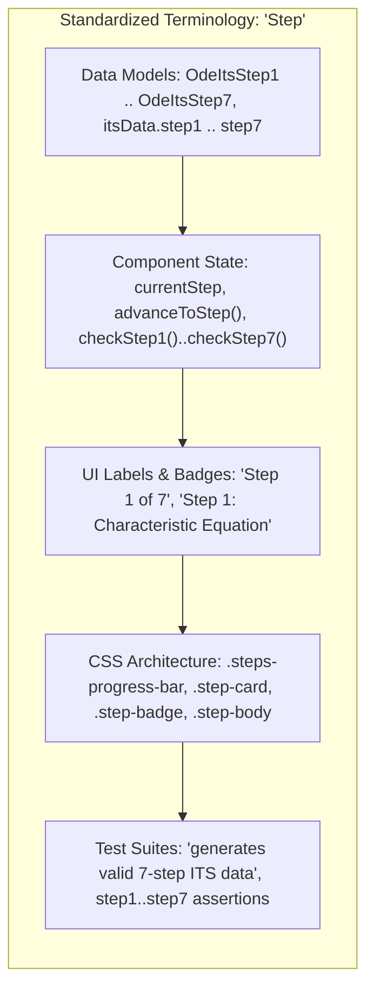

# 18. Standardized Step Terminology for Intelligent Tutoring System (ITS) Solvers

## Context and Problem Statement

In the SignalLab application, pedagogical workflows decompose complex multi-part signal processing problems into sequential questions and interactive derivation checkpoints. Historically, two distinct terms were used interchangeably across the codebase, types, UI components, and documentation:

1. **"Stage"**: Used in the initial ODEs ITS solver data models (`OdeItsStage1`..`OdeItsStage7`, `itsData.stage1`..`stage7`), state variables (`currentStage`), CSS selectors (`.stage-card`, `.stages-progress-bar`), and early architecture diagrams.
2. **"Step"**: Used in the Fourier Series stepped solver (`FourierStepSolver.svelte`, `currentStep`), the granular backend algebraic derivation pipelines (`StepReveal.svelte`, `problem.steps`), and user-facing badges ("Step 1", "Step 2").

This lexical divergence created cognitive dissonance:

- **Developer Mental Model**: Developers and agents encountered inconsistent type and field naming between modules (e.g. `problem.itsData.stage1` in ODEs vs `currentStep` in Fourier Series).
- **Learner Confusion**: Mixed terminology in headings, badges, progress trackers, and hints blurred the relationship between active question checkpoints and granular algebraic steps.
- **Rule Enforcement**: Code conventions and styling rules lacked a single canonical noun for interactive problem milestones.

## Decision Drivers

- **Pedagogical Clarity & Consistency**: A single, unambiguous term ("Step") should describe every interactive checkpoint and question piece in the tutor.
- **Codebase Uniformity (Universal Rule 9 - DRY & Shared Standards)**: Eliminate naming variations across mathematical data structures, component state variables, CSS classes, test suites, and documentation.
- **Elimination of Ambiguity**: Ensure learners, agents, and maintainers understand that solving a problem involves advancing sequentially through numbered "steps".

## Considered Options

- **Option 1: Preserve "Stage" for active solver checkpoints and "Step" for static solution breakdowns**: Treat interactive tutor checkpoints as "stages" and post-solve algebraic walkthroughs as "steps".
- **Option 2: Converge uniformly on "Step" across all active solvers, data models, state variables, UI labels, tests, and documentation**: Completely eliminate "stage" and standardize on "step" everywhere.

## Decision Outcome

Chosen Option: **Option 2**, because standardizing uniformly on **"Step"** provides full conceptual unity across the application, simplifies component logic, harmonizes math engine types (`OdeItsStep1`..`OdeItsStep7`, `itsData.step1`..`step7`), and unifies all UI badges, progress bars, and test assertions.

### Architectural & Implementation Conventions

1. **Math Engine Types**:
    - `OdeItsStage1`..`OdeItsStage7` are renamed to `OdeItsStep1`..`OdeItsStep7`.
    - `OdeItsData` fields are standardized to `step1` through `step7`.
2. **Component State & Methods**:
    - Solver components must track active progress using `currentStep`.
    - Advancement methods must use `advanceToStep(nextStep: number)`.
    - Step validation functions must follow the pattern `checkStep1()`, `checkStep2()`, etc.
3. **UI Elements & CSS Class Names**:
    - Progress trackers must use `.steps-progress-bar` and `.progress-pills`.
    - Interactive checkpoint cards must use `.step-card`, `.step-header`, `.step-badge`, `.step-title`, `.step-body`, `.step-prompt`, `.step-summary`, and `.step-actions`.
    - UI badges must render as `"Step X"`.
4. **Zero Tolerance for "Stage"**:
    - The term "stage" is deprecated and prohibited in new components, types, comments, tests, and user-facing text.

## Pros and Cons of the Options

### Option 2 (Standardize on "Step" Everywhere)

- Good, because it unifies the learner and developer mental models across all modules.
- Good, because it enables shared components (e.g. universal `Progress.svelte` component) without naming discrepancies.
- Good, because it simplifies automated testing and assertion patterns (`problem.itsData.stepX`).
- Neutral, requires updating existing ODEs test fixtures, type interfaces, and solver component templates.

### Option 1 (Dual Terminology: "Stage" vs "Step")

- Bad, creates confusion about whether a question is a "stage" or a "step".
- Bad, leads to inconsistent component API contracts across different signal practice cards.
- Bad, fragments CSS styling classes into redundant `.stage-card` and `.step-card` definitions.

## Links

- [ADR 0007: ECE 210 Standardized Solution Terminology](0007-ece-210-standardized-solution-terminology.md)
- [ADR 0010: Intelligent Tutoring System Stepped Solvers](0010-intelligent-tutoring-system-stepped-solvers.md)
- [ADR 0015: Interactive ITS Mapping for Linear Constant-Coefficient ODEs](0015-six-stage-ode-interactive-its-mapping.md)
