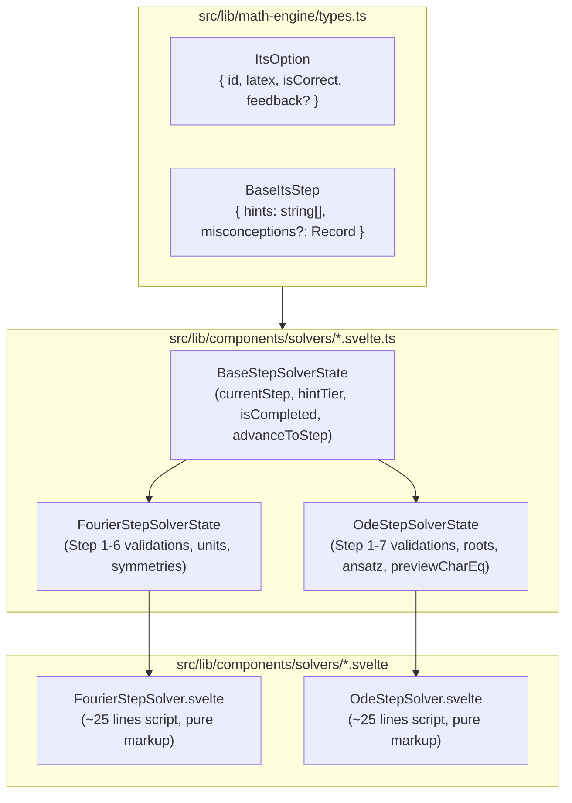

# 19. Reactive Step Solver State Controllers and Shared ITS Type Centralization

## Context and Problem Statement

As SignalLab's Intelligent Tutoring System (ITS) expanded to support multi-step stepped solvers across Fourier Series and Linear ODEs, the solver components (`FourierStepSolver.svelte` and `OdeStepSolver.svelte`) grew excessively complex:

1. **State Explosion & UI Coupling**: Each solver component managed between 20 and 30 loose `$state` variables across sequential steps (inputs, validation booleans, misconception feedback strings, hint tiers, and derived LaTeX previews). This coupled mathematical validation and state transitions directly to the Svelte rendering layer, preventing isolated unit testing without DOM overhead.
2. **Lint Suppression Overhead**: Unreferenced state variables in `<script>` blocks required extensive `// biome-ignore lint/correctness/noUnusedVariables` annotations to satisfy linter constraints.
3. **Duplicated Mathematical Type Primitives**: `OdeItsOption` and `FourierItsOption` defined identical multiple-choice option structures (`id`, `latex`, `isCorrect`, `feedback`), and step interfaces repeatedly re-declared `hints: string[]` and `misconceptions?: Record<string, string>`, violating DRY principles (Universal Rule 9).
4. **Prop Reactivity & Compiler Warnings**: Passing component props into state classes via value snapshots triggered Svelte 5's `state_referenced_locally` compiler warning and created risky duplicate state that required manual synchronization.

## Decision Drivers

- **Separation of Concerns**: Decouple domain mathematical evaluation, misconception diagnostics, and step transitions from Svelte HTML template rendering.
- **Isolated Unit Testability**: Enable exhaustive automated testing of step validation, tolerance checks, misconception feedback, and hint progression via Vitest without DOM dependencies.
- **Svelte 5 Universal Reactivity**: Leverage `.svelte.ts` state classes utilizing `$state` and `$derived.by` natively.
- **Single Source of Truth & Zero Compiler Warnings**: Connect parent reactive props to state controllers without duplicate state or `state_referenced_locally` warnings.
- **Centralized Data Contracts (Universal Rule 9)**: Unify shared ITS option and step definitions in `src/lib/math-engine/types.ts`.

## Considered Options

- **Option 1: Inline Monolithic Components**: Keep all step state, event handlers, and validation rules inside `.svelte` single-file components.
- **Option 2: Value Copy State Classes with Manual Effect Synchronization**: Move logic into TypeScript classes, storing `problem = $state(initialProblem)` and forcing parent components to synchronize updates via `$effect(() => solver.reset(problem))`.
- **Option 3: Reactive Svelte 5 Class Controllers with Getter Closures and Centralized Shared Types**: Extract logic into `.svelte.ts` classes extending a universal `BaseStepSolverState`, using reactive getter closures (`() => problem`) for prop ingestion and centralizing shared types in `types.ts`.

## Decision Outcome

Chosen Option: **Option 3**, because it provides clean separation of concerns, enables rapid unit testing, preserves fine-grained Svelte 5 reactivity without prop synchronization boilerplate, eliminates all `biome-ignore` lint suppressions, and strictly enforces DRY mathematical typing.

### Architectural & Implementation Details

1. **Shared ITS Data Contracts**:
   - `ItsOption` and `BaseItsStep` are exported from [`src/lib/math-engine/types.ts`](../../src/lib/math-engine/types.ts).
   - Domain step interfaces (`OdeItsStep1`..`OdeItsStep7`, `FourierItsStep1`..`FourierItsStep6`) extend `BaseItsStep`.
   - `OdeItsOption` and `FourierItsOption` are unified as type aliases to `ItsOption`.

2. **Universal Stepper Base Controller**:
   - [`BaseStepSolverState`](../../src/lib/components/solvers/base-step-solver.svelte.ts) manages `currentStep`, `isCompleted`, `hintTier` (3-tier cap), `advanceToStep()`, `revealNextHint()`, and completion callback execution.

3. **Reactive Getter Closure Pattern**:
   - Class constructors accept a closure getter (`getProblem: () => ProblemType`).
   - Classes expose `get problem(): ProblemType { return this.getProblem(); }`.
   - Derived calculations (`$derived.by`) reading `this.problem` automatically subscribe to parent component props, ensuring zero stale state and zero `state_referenced_locally` warnings.

4. **Step Derivations Encapsulation**:
   - Derived mathematical expressions (such as `previewCharEq` and `correctAnsatz` in `OdeStepSolverState`) are declared as `$derived.by` fields directly on the controller class, keeping mathematical derivations cohesive and testable.

5. **Lean Presentation Components**:
   - `.svelte` components instantiate a single controller instance (`const solver = new OdeStepSolverState(() => problem, () => onComplete)`).
   - Component `<script>` sections are reduced to ~25 lines with zero `biome-ignore` comments.

---

## Consequences

### Good

- **Complete Testability**: Validation rules, tolerance checking, alias matching, and misconception feedback are directly covered by fast unit test suites ([`fourier-step-solver.test.ts`](../../tests/unit/fourier-step-solver.test.ts) and [`ode-step-solver.test.ts`](../../tests/unit/ode-step-solver.test.ts)).
- **Clean Component Scripts**: Monolithic component scripts dropped from 350+ lines to ~25 lines, making presentation templates clean and readable.
- **Zero Lint Suppressions**: Completely eliminated `biome-ignore lint/correctness/noUnusedVariables` from solver files.
- **DRY Adherence**: Shared multiple-choice options and step metadata definitions are maintained in a single central module.
- **Fine-Grained Svelte 5 Reactivity**: Props flow cleanly through getter closures without manual `$effect` sync code.

### Bad

- **Slight Indirection**: UI templates access properties via `solver.step1.a2` rather than top-level variables.

### Neutral

- **Module Organization**: Added `.svelte.ts` companion files for each interactive ITS step solver in `src/lib/components/solvers/`.
