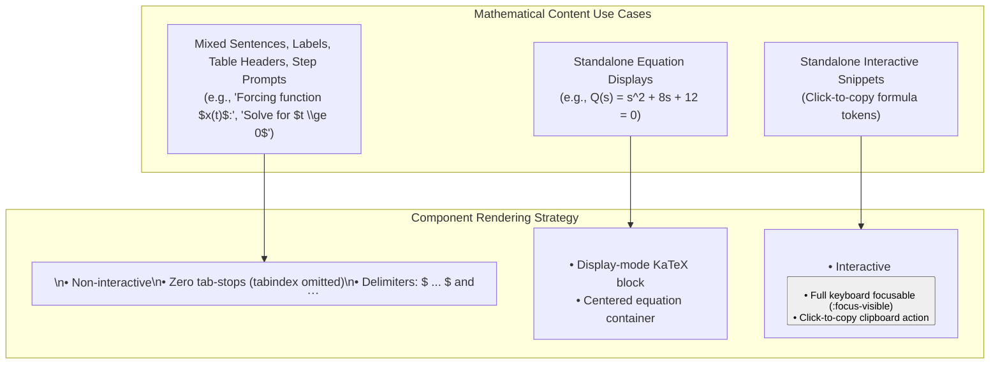

# 20. MathText Prose Rendering and Keyboard Navigation Accessibility

## Context and Problem Statement

SignalLab enforces strict zero-Unicode math and LaTeX rendering (Universal Rules 1 & 2). In earlier iterations, inline mathematical variables, equations, and expressions embedded within sentences, labels, descriptions, and table cells were rendered by inserting one or more `<MathInline>` components directly inside plain HTML text blocks (e.g. `<p>Calculate <MathInline math={"y(t)"} /> for <MathInline math={"t \\ge 0"} /></p>`).

However, `<MathInline>` renders as an interactive HTML `<button>` featuring `tabindex="0"`, focus styling (`:focus-visible`), and a click-to-copy clipboard mechanism for standalone formulas. This implementation created significant usability and accessibility (a11y) barriers:

1. **Keyboard Navigation / Tab-Stop Bloat**: Users navigating via keyboard (Tab / Shift+Tab) were forced to step through every single individual mathematical variable and symbol as separate focusable button stops before reaching actionable form inputs, buttons, and solver controls.
2. **Asymmetric Interaction Model**: In a sentence composed of plain text and inline math, the plain text was static while the math fragments were interactive buttons, disrupting screen reader flow and causing cognitive friction.
3. **Svelte Template Attribute Parsing Hazards**: Passing LaTeX expressions containing curly braces (`{...}`) directly inside double-quoted attributes (e.g. `<MathText text="$C_1 e^{r_1 t}$" />`) caused Svelte's template compiler to misinterpret `{r_1 t}` as JavaScript interpolation blocks, triggering compiler parse errors (`https://svelte.dev/e/expected_token`).

## Decision Drivers

- **Keyboard Navigation & Accessibility (WCAG 2.1 Focus Order)**: Ensure keyboard tab order navigates only genuinely actionable controls (inputs, toggles, interactive buttons) without stopping on every inline math variable in prose.
- **Unified Math Prose Rendering**: Enable complete sentences and labels containing mixed text and LaTeX (e.g., `text="Input Signal $x(t)$:"` or `text="$y(t) = y_{ZI}(t) + y_{ZS}(t)$"`) to render seamlessly inside a single non-interactive semantic `<span>`.
- **Preservation of Interactive Math Snippets**: Retain `<MathInline>` as an interactive, copyable component for standalone math snippets where copy-to-clipboard functionality is desirable.
- **Template Robustness with `String.raw`**: Prevent Svelte template attribute interpolation conflicts and JavaScript escape sequence corruption (`\frac`, `\omega`, `\sigma`, `\cos`, `\sin`) by establishing standard string passing conventions.

## Considered Options

- **Option 1: Strip Interactivity from `<MathInline>` Globally**: Modify `<MathInline>` to render as a non-interactive `<span>` for all use cases, removing the button element and copy-to-clipboard functionality everywhere.
- **Option 2: Maintain `<MathInline>` for Everything with Manual `tabindex="-1"` Props**: Keep using `<MathInline>` everywhere but add an optional prop (`focusable={false}`) to suppress keyboard tab-stops.
- **Option 3: Adopt `<MathText>` for Prose/Labels & Preserve `<MathInline>` for Copyable Snippets**: Migrate all embedded sentences, labels, table cells, and step prompts to `<MathText>` (which parses `$ ... $` and `$$ ... $$` delimiters into non-interactive inline KaTeX spans), while keeping `<MathInline>` dedicated to standalone interactive/copyable formulas. Mandate `text={String.raw`...`}` for all LaTeX strings with backslashes or curly braces.

## Decision Outcome

Chosen Option: **Option 3**, because it provides clear separation between non-interactive prose math and standalone interactive formula controls, eliminates keyboard tab-stop clutter, adheres to WCAG accessibility principles, and eliminates Svelte template interpolation errors via `String.raw`.



### Technical Implementation Standards

1. **Component Selection**:
   - Use `<MathText>` for all user-facing prose, step prompts, card subtitles, button descriptive labels, table cells, and parameter inputs.
   - Use `<MathBlock>` for multi-line or display-style centered derivations and equations.
   - Reserve `<MathInline>` exclusively for standalone formula tokens that explicitly require click-to-copy behavior.

2. **Template Attribute Escaping with `String.raw`**:
   - Any string containing LaTeX macros or backslashes (`\`) MUST be passed using `String.raw` template literals:
     ```svelte
     <MathText text={String.raw`$y_h(t) = e^{\sigma t}[C_1 \cos(\omega_d t) + C_2 \sin(\omega_d t)]$`} />
     <MathText text={String.raw`Fundamental Frequency $\omega_0 = \frac{2\pi}{T_0}$:`} />
     ```
   - For strings containing math without backslashes, wrap with JavaScript expression braces:
     ```svelte
     <MathText text={"Input Signal $x(t)$:"} />
     <MathText text={"Constant ($a_0$):"} />
     ```
   - Never use raw double-quoted attributes `text="..."` with LaTeX containing curly braces `{...}`, as Svelte interprets them as template JavaScript expressions.

## Consequences

### Positive Consequences

- **Streamlined Keyboard Accessibility**: Tab key navigation moves directly between genuine inputs and controls without dozens of extraneous stops on static math symbols.
- **Natural Reading Flow**: Screen readers and visual users experience continuous, unbroken text and math layouts without fragmented button boundaries.
- **Zero Svelte Syntax Errors**: `String.raw` prevents backslash escape sequence corruption (`\f`, `\t`, `\s`) and Svelte template compiler token errors.
- **Preserved Feature Set**: Standalone formulas still retain their dedicated copy-to-clipboard functionality where appropriate through `<MathInline>`.

### Negative Consequences / Trade-offs

- **Two Inline Math Components**: Developers must remember the distinct use cases between `<MathText>` (prose/labels with `$ ... $`) and `<MathInline>` (standalone raw math string).
- **String.raw Discipline**: Requires consistent adherence to wrapping LaTeX attributes in `String.raw` to prevent syntax regressions.
