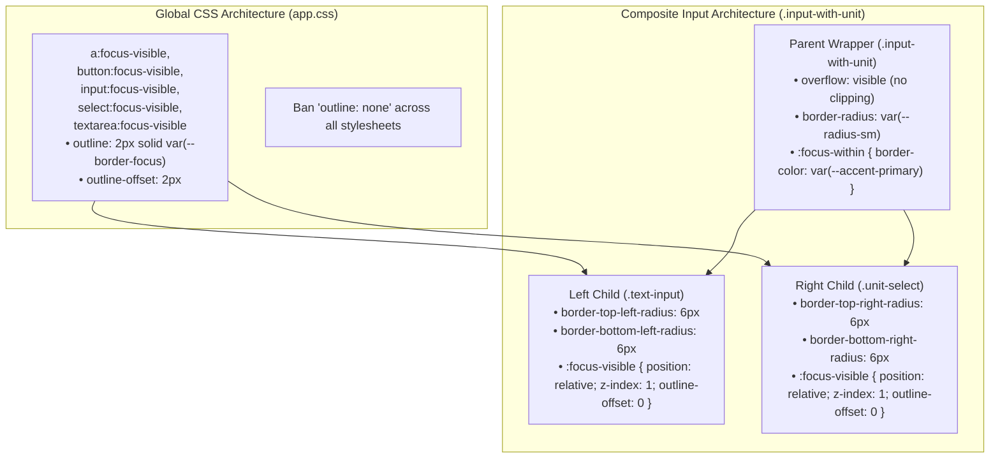

# 21. Focus-Visible Keyboard Accessibility and Stacking Context Elevation

## Context and Problem Statement

Keyboard navigation and visual focus indication are core accessibility requirements (WCAG 2.1 Success Criterion 2.4.7: Focus Visible) and are explicitly mandated by SignalLab Universal Rule #8. During a comprehensive audit of interactive controls across SignalLab, two significant accessibility and UI rendering issues were identified:

1. **Suppression of Focus Rings via `outline: none`**: Multiple custom math input components, route controls, solver text fields, and global button styles applied `outline: none;` without providing a companion `:focus-visible` outline. While mouse interactions appeared clean, keyboard users navigating with Tab / Shift+Tab received zero visual indication of which input or dropdown was currently active.
2. **Clipping and Stacking Occlusion in Composite Controls**: In composite input groups (such as `.input-with-unit` pairing a text input with an attached unit `<select>`), two compounding visual bugs occurred:
   - The parent container declared `overflow: hidden;` to clip square background corners to the wrapper's `border-radius`, which clipped off outer focus rings (`outline-offset > 0`).
   - In normal DOM flow, the `<select class="unit-select">` rendered after `<input class="text-input">` with an opaque background (`background: var(--bg-secondary)`), painting over and occluding the right-hand edge and corners of the text input's focus outline.
   - A floating `outline-offset: 2px` caused focus rings to protrude awkwardly outside composite borders.

## Decision Drivers

- **WCAG 2.1 Focus Visible Compliance (Criterion 2.4.7)**: Ensure every interactive element (`<a>`, `<button>`, `<input>`, `<select>`, `<textarea>`) provides a clear, high-contrast visual focus ring when focused via keyboard navigation.
- **Zero Anti-Pattern `outline: none`**: Ban the use of `outline: none` or `outline: 0` unless accompanied by an explicit, accessible `:focus-visible` replacement.
- **Zero-Clipping for Focus Rings**: Eliminate `overflow: hidden` on composite form wrappers so focus rings and tooltips are never cut off.
- **Flawless 4-Sided Focus Ring Geometry**: Guarantee that adjacent sibling elements within composite controls do not paint over or occlude any segment of the active element's focus ring.
- **Snug Alignment with `outline-offset: 0`**: Keep focus rings closely bound to input and selector borders without floating or protruding outside parent containers.

## Considered Options

- **Option 1: Browser-Native Default Outlines Only**: Remove all custom focus styles and rely entirely on native browser focus rings. *(Rejected: Default browser focus rings are inconsistent across platforms, clash with custom dark mode themes, and often fail color contrast ratios).*
- **Option 2: Focus Highlighting via CSS `:focus` State**: Apply custom outline/border changes on `:focus` across all elements. *(Rejected: Triggers focus outlines during mouse clicks, creating visual noise and clutter for pointer users).*
- **Option 3: Centralized `:focus-visible` Defaults with Stacking Context Elevation**: 
  - Define global fallback `:focus-visible` rules in `src/app.css` for `a`, `button`, `input`, `select`, and `textarea` using `outline: 2px solid var(--accent-primary)`.
  - Remove all occurrences of `outline: none` across the codebase.
  - Remove `overflow: hidden` from composite containers and highlight the wrapper using `:focus-within`.
  - Elevate focused composite children in the z-axis using `position: relative; z-index: 1;` so all 4 edges of the focus outline render cleanly above sibling controls.
  - Set `outline-offset: 0;` on composite inputs for snug border alignment.

## Decision Outcome

Chosen Option: **Option 3**, because it enforces complete keyboard accessibility across all components, eliminates focus ring clipping, fixes DOM stacking occlusion on composite inputs, and aligns with SignalLab's visual design standards.



### Technical Implementation Standards

1. **Global `:focus-visible` Defaults**:
   In `src/app.css`, all interactive elements inherit consistent high-contrast focus rings:
   ```css
   a:focus-visible,
   button:focus-visible,
   input:focus-visible,
   select:focus-visible,
   textarea:focus-visible {
       outline: 2px solid var(--border-focus);
       outline-offset: 2px;
   }
   ```

2. **Composite Input Groups (`.input-with-unit`)**:
   - **No `overflow: hidden`**: The container must allow child outlines to paint freely outside boundaries without clipping.
   - **Individual Corner Radii**: Left and right children receive explicit corner radii matching the container (`border-top-left-radius` / `border-top-right-radius`).
   - **Stacking Elevation**: Focused children apply `position: relative; z-index: 1;` so their outline rectangle paints over adjacent sibling borders:
     ```css
     .text-input:focus-visible {
         position: relative;
         z-index: 1;
         outline: 2px solid var(--accent-primary);
         outline-offset: 0;
     }

     .unit-select:focus-visible {
         position: relative;
         z-index: 1;
         outline: 2px solid var(--accent-primary);
         outline-offset: 0;
     }
     ```
   - **Container Highlight via `:focus-within`**:
     ```css
     .input-with-unit:focus-within {
         border-color: var(--accent-primary);
     }
     ```

## Consequences

### Positive Consequences

- **Universal Keyboard Accessibility**: Clear, accessible focus indicators are displayed when navigating via Tab across all pages, builders, and solvers.
- **Zero Clipping & Zero Occlusion**: Focus rings remain fully visible on all 4 sides, including the shared junction between inputs and attached unit selects.
- **Clean Aesthetic**: `outline-offset: 0` ensures focus rings snugly hug the control boundaries rather than floating into whitespace.
- **Maintainable Standards**: Global defaults prevent newly created inputs from accidentally omitting focus indicators.

### Negative Consequences / Trade-offs

- **Explicit Corner Radii Overhead**: Because `overflow: hidden` is removed, composite groups must explicitly assign border radii to their first and last child elements.
