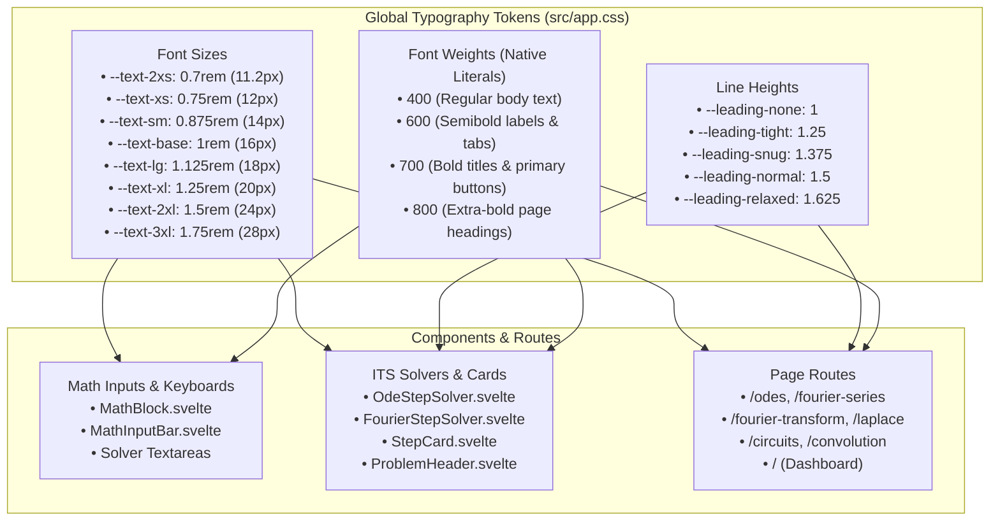

# 22. Modular Typography Scale and Native Numeric Font Weights

## Context and Problem Statement

As SignalLab expanded across six interactive practice modules (ODEs, Fourier Series, Fourier Transform, Laplace Transform, Circuits, Convolution) and intelligent tutoring system (ITS) stepped solvers, font sizes across components and routes diverged into arbitrary fractional `rem` values (e.g. `0.72rem`, `0.75rem`, `0.78rem`, `0.8rem`, `0.85rem`, `0.88rem`, `0.9rem`, `0.95rem`, `1.1rem`, `1.15rem`, `1.75rem`, `2.25rem`).

This fragmentation introduced several maintainability and design consistency issues:

1. **Inconsistent Visual Hierarchy**: Sibling cards, input headers, formula prompt labels, and navigation buttons rendered at subtly different font sizes across different routes.
2. **Arbitrary Fractional Steps**: Without a unified typographic scale, component authors picked arbitrary font sizes that complicated refactoring and theme updates.
3. **Responsive Scaling Complexity**: ADR 0016 mandates strict WCAG 2.1 Reflow down to $320\text{px}$ viewports. Ad-hoc font sizes made fluid downscaling unpredictable across nested container queries.
4. **Font Weight Strategy**: Whether font weights should be abstracted into CSS custom properties (e.g. `--font-weight-bold: 700`) or retained as native CSS numeric literals (`600`, `700`, `800`).

## Decision Drivers

- **System-Wide Typographic Cohesion**: Establish a standardized, modular 8-tier font-size scale and line-height tokens in `src/app.css` referenced by all components and pages.
- **Narrow Viewport ($320\text{px}$) Fluidity (Universal Rule #11 & ADR 0016)**: Enable predictable font size stepping for small-screen media and container queries without horizontal overflow.
- **Maintainable Design Token Architecture (Universal Rule #9)**: Eliminate arbitrary fractional font sizes across components, replacing them with single-source tokens.
- **Zero-Overhead Font Weight Rendering**: Maintain standard CSS numeric literals (`400`, `600`, `700`, `800`) for font weights to avoid variable indirection without semantic benefit.

## Considered Options

- **Option 1: Ad-hoc Component Font Sizes**: Allow components to define arbitrary `font-size` values in local `<style>` blocks. _(Rejected: Causes visual inconsistencies and makes global responsive adjustments fragile)_.
- **Option 2: Fully Abstracted CSS Variables for Sizes and Weights**: Define `--text-*` scale tokens as well as `--font-weight-regular: 400`, `--font-weight-semibold: 600`, `--font-weight-bold: 700`, etc. _(Rejected: Abstracting standard numeric weights creates unnecessary CSS variable overhead without providing functional flexibility, since font weights map directly to standard OpenType font weight values)_.
- **Option 3: Modular Font-Size Scale and Line Heights with Native Numeric Font Weights**:
    - Centralize an 8-tier modular font-size scale (`--text-2xs` to `--text-3xl`) and line-height tokens (`--leading-none` to `--leading-relaxed`) in `:root` inside `src/app.css`.
    - Retain standard numeric font weights (`400`, `600`, `700`, `800`) in component styles.
    - Standardize all UI components, math input builders, stepped solvers, and route views to use `--text-*` tokens.

## Decision Outcome

Chosen Option: **Option 3**, because it provides strict visual consistency, predictable responsive scaling across mobile viewports, and clean maintainability while avoiding superfluous CSS custom property indirection for standard font weights.



### Typography Scale Specification

| Token         | Size (`rem`) | Equivalent (`px`) | Primary Usage                                                               |
| ------------- | ------------ | ----------------- | --------------------------------------------------------------------------- |
| `--text-2xs`  | `0.7rem`     | $11.2\text{px}$   | Micro badges, formula copy button, keycap annotations                       |
| `--text-xs`   | `0.75rem`    | $12\text{px}$     | Step number badges, input legends, preview status tags                      |
| `--text-sm`   | `0.875rem`   | $14\text{px}$     | Action buttons, completed step summaries, drawer nav items, control labels  |
| `--text-base` | `1rem`       | $16\text{px}$     | Standard body text, problem statement descriptions, formula input textareas |
| `--text-lg`   | `1.125rem`   | $18\text{px}$     | Step titles, card subtitles, navigation brand title, mobile problem titles  |
| `--text-xl`   | `1.25rem`    | $20\text{px}$     | Problem card titles, formula drawer headers, section subtitles              |
| `--text-2xl`  | `1.5rem`     | $24\text{px}$     | Module section headers, completion banner titles, mobile hero titles        |
| `--text-3xl`  | `1.75rem`    | $28\text{px}$     | Page hero headings, dashboard title                                         |

### Implementation in Global Styles (`src/app.css`)

```css
:root {
	/* Typography scale */
	--text-2xs: 0.7rem;
	--text-xs: 0.75rem;
	--text-sm: 0.875rem;
	--text-base: 1rem;
	--text-lg: 1.125rem;
	--text-xl: 1.25rem;
	--text-2xl: 1.5rem;
	--text-3xl: 1.75rem;

	/* Line height tokens */
	--leading-none: 1;
	--leading-tight: 1.25;
	--leading-snug: 1.375;
	--leading-normal: 1.5;
	--leading-relaxed: 1.625;
}
```

## Consequences

### Positive

- **Unified Typographic Hierarchy**: Every UI element, card header, solver step, and route view aligns with a clean 8-step modular scale.
- **Predictable Mobile Scaling**: Adjusting headings from `--text-3xl` to `--text-2xl` or `--text-xl` to `--text-lg` on narrow viewports ($320\text{px}$) is straightforward and consistent.
- **Zero CSS Weight Bloat**: Keeping font weights as native CSS numbers (`600`, `700`, `800`) avoids superfluous custom property lookups while adhering to web standards.
- **Refactoring Ease**: Changing base proportions or global scaling can be performed centrally in `src/app.css` without modifying dozens of individual Svelte components.

### Negative

- **Migration Discipline**: Future component development must strictly use `var(--text-*)` rather than arbitrary rem values.

## Validation

1. **Static Type & Syntax Check**: Ran `npm run check` with 0 errors and 0 warnings.
2. **Automated Unit Testing**: Ran `npm test` verifying all 24 test suites and 243 unit tests passed.
3. **Production Build**: Ran `npm run build` with clean static bundle generation in $< 4\text{s}$.
4. **WCAG Reflow Compliance**: Verified clean rendering without horizontal scroll on $320\text{px}$ mobile viewport across all six practice routes and dashboard.
