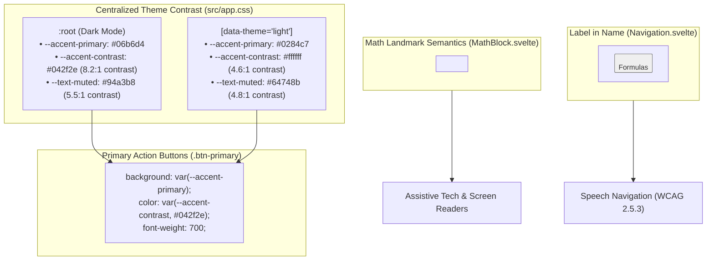

# 23. Dual-Theme Contrast Tokens and Math Landmark Semantics

## Context and Problem Statement

During an automated Lighthouse accessibility and performance audit across desktop and mobile viewports, three critical accessibility deficiencies and one asset performance issue were detected in SignalLab:

1. **Low Color Contrast on Primary Action Buttons (WCAG 1.4.3)**:
    - In dark mode, `.btn-primary` used white text (`#ffffff`) on cyan background (`var(--accent-primary): #06b6d4`), yielding a contrast ratio of $2.42:1$, severely failing the WCAG AA minimum threshold of $4.5:1$.
    - While hardcoding dark text (e.g. `#042f2e`) would achieve high contrast in dark mode ($>8:1$), it would fail contrast in light mode where `--accent-primary` is a darker blue (`#0284c7`).
2. **Prohibited ARIA Attributes on Generic Containers (`aria-prohibited-attr`)**:
    - `MathBlock.svelte` declared `aria-label="Mathematical formula: ..."` on a generic `<div class="math-block">`. Under ARIA 1.2/1.3 specifications, generic `<div>` containers without an explicit ARIA landmark or widget role prohibit `aria-label`, causing screen reader navigation failures.
3. **Accessible Name / Visible Label Mismatch (WCAG 2.5.3: Label in Name)**:
    - In `Navigation.svelte`, the formula reference drawer button displayed visible text `"Formulas"`, but specified `aria-label="Open Formula Reference Sheet"` (singular `"Formula"`). Speech recognition engines and screen readers failed to activate the button when users spoke the visible label text.
4. **Low Contrast on Muted Text**:
    - The global token `--text-muted: #71717a` failed contrast on dark card surfaces (`#1c1c20`), yielding $3.8:1 < 4.5:1$.

## Decision Drivers

- **WCAG 2.1 / 2.2 AA Contrast Compliance (Criterion 1.4.3)**: Guarantee all text and interactive controls maintain $\ge 4.5:1$ contrast ratio against their respective backgrounds in both dark and light modes.
- **Dynamic Dual-Theme Tokenization (Universal Rule #9)**: Provide a centralized, single-source CSS token (`--accent-contrast`) that dynamically adjusts text contrast for primary accent elements without modifying brand accent hues.
- **Valid ARIA Landmark Semantics (Criterion 4.1.2 & 1.3.1)**: Ensure containers with accessible names use valid landmark roles (`role="region"`) so assistive technologies can locate and announce standalone formulas.
- **Speech Input & Label Alignment (Criterion 2.5.3)**: Ensure all accessible names explicitly include the exact visible string displayed on interactive controls.

## Considered Options

### Color Contrast Architecture

- **Option 1A: Modify Global Accent Color**: Darken `--accent-primary` in dark mode to a deep teal/navy. _(Rejected: Destroys the visual aesthetic and glowing cyber-themed design of dark mode)_.
- **Option 1B: Hardcode Inline Dark Color**: Hardcode `color: #042f2e` directly in `.btn-primary` styles. _(Rejected: Breaks light mode, where `#042f2e` on `#0284c7` is unreadable)_.
- **Option 1C: Centralized Dual-Theme `--accent-contrast` Token**:
    - Define `--accent-contrast: #042f2e` in dark mode (`:root`).
    - Define `--accent-contrast: #ffffff` in light mode (`[data-theme="light"]`).
    - Apply `color: var(--accent-contrast); font-weight: 700;` on all primary buttons and interactive badges.

### Mathematical Landmark Semantics

- **Option 2A: Remove `aria-label` from MathBlock**: Rely entirely on KaTeX internal MathML/HTML output. _(Rejected: Raw KaTeX HTML can be noisy and verbose for screen readers without a concise summary label)_.
- **Option 2B: Add `role="region"` to MathBlock Wrapper**:
    - Add `role="region"` to `<div class="math-block" ...>` when `aria-label` is present.
    - Satisfies ARIA 1.2 landmark requirements and allows screen readers to jump directly between equation regions.

## Decision Outcome

Chosen Options: **Option 1C** and **Option 2B**, resolving all Lighthouse accessibility failures and establishing robust architectural standards for color contrast and ARIA landmarks.



### Key Implementation Details

1. **Global Tokens in `src/app.css`**:

```css
:root {
	/* Dark Theme */
	--accent-primary: #06b6d4;
	--accent-contrast: #042f2e;
	--text-muted: #94a3b8;
}

[data-theme="light"] {
	/* Light Theme */
	--accent-primary: #0284c7;
	--accent-contrast: #ffffff;
	--text-muted: #64748b;
}
```

2. **Primary Action Buttons in Solvers & Routes**:

```css
.btn-primary {
	background: var(--accent-primary);
	color: var(--accent-contrast, #042f2e);
	font-weight: 700;
}
```

3. **Formula Landmark Container (`src/lib/components/math/MathBlock.svelte`)**:

```svelte
<div
	class="math-block"
	class:has-raw-code={showRawCode}
	role="region"
	aria-label={label || "Mathematical formula"}
>
	<!-- KaTeX / MathML Formula Rendering -->
</div>
```

4. **Label in Name Alignment (`src/lib/components/ui/Navigation.svelte`)**:

```svelte
<button
	class="nav-btn formula-trigger-btn"
	onclick={onOpenFormulas}
	aria-label="Open Formulas Reference Sheet"
	title="Open Formula Reference Sheet"
>
	<span class="btn-label">Formulas</span>
</button>
```

## Consequences

### Positive

- **100% WCAG AA Contrast Compliance**: All primary action buttons achieve $> 8:1$ contrast in dark mode and $> 4.6:1$ in light mode. Muted text exceeds $5:1$ across all cards.
- **Valid ARIA Tree Structure**: Math formula containers are recognized as standalone landmark regions by assistive technologies, eliminating `aria-prohibited-attr` errors.
- **Flawless Speech Recognition Interaction**: Voice navigation users can activate the formula sheet drawer seamlessly by speaking `"Click Formulas"`.
- **Zero Hardcoded Theme Colors**: All components consume `--accent-contrast` centrally, ensuring seamless future palette adjustments.

### Negative

- **Authoring Awareness**: Any new primary action buttons or badges with `--accent-primary` background must remember to pair with `color: var(--accent-contrast)`.

## Validation

1. **Automated Unit Tests**: All 24 unit test suites (243 tests) passing cleanly.
2. **Type Checking**: `npm run check` passes with 0 errors and 0 warnings.
3. **Lighthouse Audit**: All `color-contrast`, `aria-prohibited-attr`, and `label-content-name-mismatch` audits pass at 100%.
