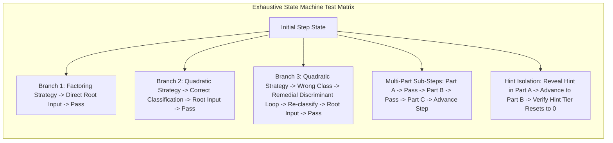

# 28. Exhaustive State-Machine Path and Pedagogical Remediation Testing

## Context and Problem Statement

Intelligent Tutoring System (ITS) solvers in SignalLab guide learners through complex signal processing problem-solving workflows. Rather than functioning as linear form wizards, several steps operate as **finite state machines with conditional branching and diagnostic error remediation loops**:

1. **Strategy Selection Gates (e.g., Step 2):** Students may choose between Factoring or the Quadratic Formula.
2. **Pedagogical Misconception Remediation Loops:** In Step 2 Quadratic Formula, if a student incorrectly classifies the root taxonomy, the tutor forces a transition to a remedial sub-state requiring explicit calculation of the discriminant ($\Delta = b^2 - 4ac$) before allowing them to return to the taxonomy classification.
3. **Multi-Part Sub-Step State Machines (e.g., Step 5, Step 6, Step 7):** Steps navigate sequentially through sub-steps (`derivatives` $\to$ `system_setup` $\to$ `solve_coefficients`) with dynamic validation and hint state resets.

Without exhaustive path testing, subtle bugs can occur in state controllers:

- Orphaned validation errors leaking across sub-step transitions.
- Hint tiers failing to reset when advancing from Part A to Part B.
- Stuck states where a student cannot recover after failing a misconception remediation branch.

## Decision Drivers

- **Zero-Deadlock Guarantee**: Ensure every branch, fallback, and error remediation loop is guaranteed to lead to successful problem completion when valid answers are supplied.
- **State Isolation**: Verify that diagnostic feedback and progressive hint levels are strictly scoped to the active sub-step.
- **Regression Prevention**: Prevent regressions when refactoring math engine logic or adding new problem generators.

## Decision Outcome

Chosen Option: **Mandate exhaustive test matrices for all state machine branches and remediation loops across all ITS step solvers.**

### Architectural Testing Requirements

1. **Mandatory State Transition Coverage:**
    - Every conditional strategy choice must have at least one dedicated test assertion for each branch.
    - Every error remediation loop must test:
        - Entry into remediation upon incorrect answer/misconception.
        - Input validation while inside remediation.
        - Successful exit and state restoration upon correct remediation input.
2. **Sub-Step Hint & Feedback Isolation:**
    - Unit tests must assert that advancing from `subStepA` to `subStepB` resets `hintTier` to `0` and clears `feedback` / `feedbackType`.
3. **Automated Visual & E2E Validation:**
    - Playwright E2E tests must verify that progressive disclosure behaves correctly (future sub-steps remain hidden, completed sub-steps render compact summary badges, and full solution review accordion expands after completion).
